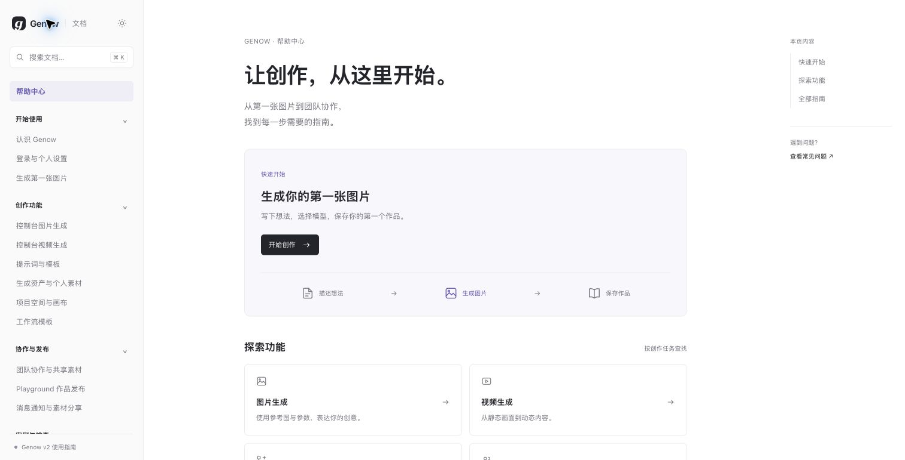
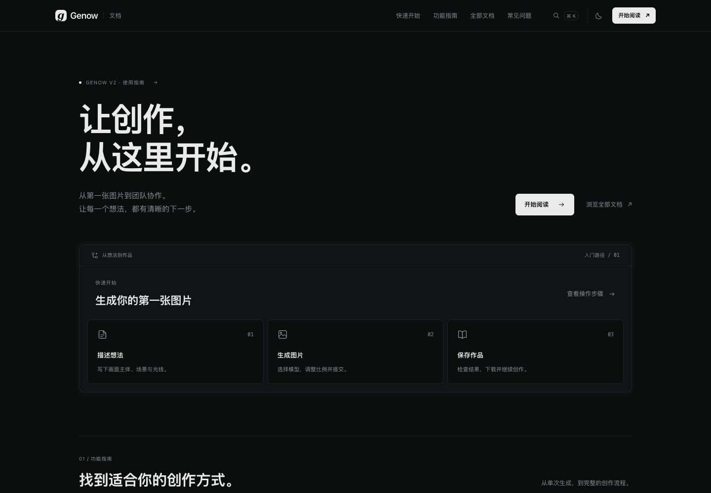

# 帮助中心实施记录

日期：2026-10-22。实现仓库：genow-wiki。

## 交付范围

- 保留 Next.js 16、React 19 和静态导出；无运行时后端。
- 迁移用户手册的 16 章及附录 A–C，共 19 篇文章，分为 6 个模块。
- 附录 D 的开发维护依据放在 `docs/manual-maintenance.md`。
- 默认深色，文章采用三栏布局，提供浅色模式、模块折叠、滚动目录、相邻文章、复制链接、移动抽屉导航。
- Pagefind 1.5.2 Extended 中文全文搜索，按需加载；支持快捷键、摘要高亮和章节跳转。
- 5 个旧版地址保留新版指引；原内容存于 `docs/legacy/`，未删除原媒体资产。

## 内容维护

编辑 `content/` Markdown；新增文章时设置 title、description、group、order。模块列表由 `content/navigation.json` 管理。内部链接使用 `/wiki/模块/文章/`；章节锚点由标题生成，修改标题时同时检查引用。

构建会校验所有页面内部链接、章节锚点、导航、索引范围和媒体引用。原始单文件中的章节编号已转成新站文章链接，便于直接访问。

## 验证

- `npm test`：内容加载、元数据、Markdown 标题和排版、中文路径、媒体同步。
- `npm run build`：静态页面导出，19 篇中文索引生成，内部链接和锚点验证。
- `npm run typecheck`：TypeScript 检查。
- Chrome 实机浏览器：桌面首页与文章、中文搜索“参考图”、结果摘要、方向键选择与回车跳转、390 × 844 窄屏阅读与抽屉导航、深色模式和刷新保留。
- 在已检查的页面上未发现浏览器控制台错误；390 像素视口的文档宽度为 390，无页面横向溢出。

## 运行与发布

本地查看：在项目根目录执行 `npm run preview -- --port 3004`。线上发布产物为 `frontend/out/` 的全部内容，包含 `pagefind/`。文档根路径部署可直接使用，子路径部署需另行配置。

此次完成本地实现和验证，未配置线上域名、远程发布或业务应用中的帮助链接。明确正式文档域名后，再将 genow-v2 的帮助入口指向它。

当前站点为静态使用指南，管理员章节没有登录保护。`hidden` 仅用于导航与搜索排除，不能用来存放需保密的内容。若后续需要受限访问，应由部署层统一保护页面、搜索索引和媒体。

开发模式下搜索使用最近一次构建索引；修改正文后需要重新构建。已有图片与视频组件保留，但旧版媒体尚未核对新版界面，因此本次没有将其混入新版文章。

## 界面预览

## 2026-10-23：Linear 官网视觉调整

参考 https://linear.app/ 当前官网的近黑背景、灰白文字、细边框、顶部导航和大标题，重做首页入口与功能分区；保留 Genow 品牌及 19 篇手册。文章页保留三栏阅读布局，统一搜索弹窗、目录、卡片与主题样式，默认深色并保留用户已有的浅色偏好。

验证：生产构建（含 TypeScript）及全部静态导出链接检查通过；浏览器检查桌面文章三栏、中文搜索“参考图”、390 × 844 手机首页及导航抽屉。手机首页宽度为 390，没有横向溢出；检查时未发现控制台错误。此次仅调整样式，未制作说明图片或视频。

## 2026-10-23：核心功能图像与视频说明

在生成第一张图片、图片生成、视频生成、项目空间与画布、工作流模板、生成资产与个人素材共 6 篇指南中加入 9 张截图及 4 条 15 秒静音分步短片。使用真实产品组件的隔离演示场景，控制台无历史，素材仅一张咖啡杯示意图，画布仅两个节点。未调用业务生成服务。

视频新增封面、WebVTT、下载与加载失败提示；文字步骤仍可被全文搜索。构建新增教程资源完整性检查；制作工程、隔离页面和来源摘要保存在 `docs/media-production/`。
